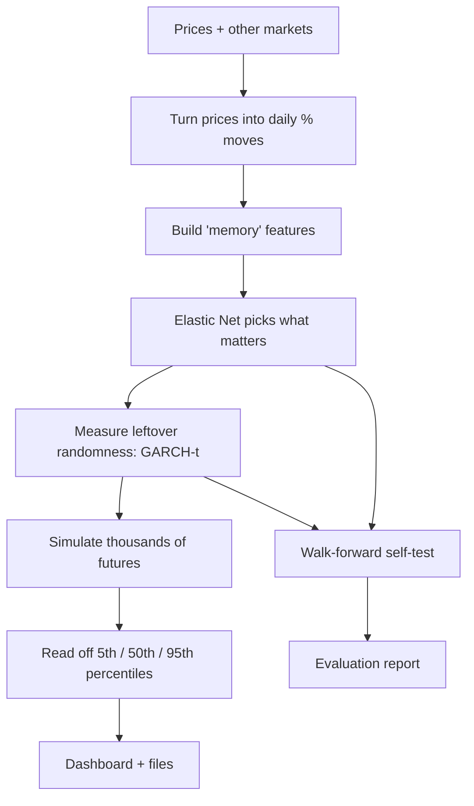

# GLE/VARX Financial Forecaster

**A single-file Python tool that turns a history of USD/INR prices (plus a few other markets) into a *range of possible futures*, and then honestly checks whether that range is any good.**

It also builds a self-contained, interactive HTML dashboard, and can extend that dashboard to gold and Brent crude.

> **In one sentence:** it learns how yesterday's rupee move and other markets' moves tend to shape tomorrow's rupee move, simulates thousands of possible futures from that, and tests itself against the hardest benchmark in currency forecasting: "tomorrow will be the same as today."

---

## Table of contents

1. [What is this?](#1-what-is-this)
2. [What can I use it for (and not use it for)?](#2-what-can-i-use-it-for-and-not-use-it-for)
3. [Quick start (10 minutes)](#3-quick-start-10-minutes)
4. [Preparing your data](#4-preparing-your-data)
5. [Everyday recipes](#5-everyday-recipes)
6. [How it works, in plain English](#6-how-it-works-in-plain-english)
7. [How to read the results](#7-how-to-read-the-results)
8. [The multi-asset dashboard (USD/INR + Gold + Brent)](#8-the-multi-asset-dashboard-usdinr--gold--brent)
9. [Full command reference](#9-full-command-reference)
10. [Output files explained](#10-output-files-explained)
11. [Troubleshooting](#11-troubleshooting)
12. [Honest limitations](#12-honest-limitations)

---

## 1. What is this?

Imagine you want to know where the rupee might be in 30 days. Nobody can tell you the exact number. What you *can* get is a **range**: "there is a 90% chance, under this model, that it lands between A and B, and the middle estimate is M."

This tool produces that range. It does four things, in order:

| Step | Plain-English meaning | Technical name |
|---|---|---|
| **1. Learn** | Find out how past returns and other markets influence the next day's rupee move | Sparse linear regression (Elastic Net) with exponential-memory features |
| **2. Measure the noise** | Measure the "randomness left over" and how it comes in waves of calm and panic | GARCH(1,1) with Student-t errors |
| **3. Simulate** | Roll the dice thousands of times to produce thousands of possible futures | Monte Carlo simulation |
| **4. Check itself** | Test, on data the model never saw, whether it beats "no change" | Walk-forward evaluation, Clark-West test, CRPS, PIT diagnostics |

The name comes from the physics idea behind it: a **Generalized Langevin Equation (GLE)**. It says that one thing you observe (the exchange rate) is pushed around by outside forces (other markets) *and* by its own recent history (memory), plus random noise. "VARX" is the discrete, day-by-day version of that statement: a regression on the past of the series plus external inputs.

### What the tool is *not*

- Not a live price feed. Every number is a model scenario, not a quote you can trade at.
- Not a trading signal generator.
- Not a promise that the model beats a coin-flip-style benchmark. The evaluation reports exist precisely so you can see whether it does.

---

## 2. What can I use it for (and not use it for)?

**Good uses**

- **Scenario ranges** for planning: "what range should I think about for the next month or quarter?"
- **Research**: testing whether other markets (oil, gold, VIX, equities, US yields, the broad dollar) *lead* USD/INR by one day, and whether the rupee's own recent history helps predict it.
- **Benchmarking**: a rigorous baseline to compare fancier models against.
- **Learning**: a worked example of regularized regression, volatility modelling, simulation, and proper forecast evaluation, all in one readable file.
- **Other assets**: any positive daily price series can be fed in the same way (labels on the dashboard say USD/INR, but the maths is generic).

**Not good uses**

- Betting money on a single forecasted number.
- Treating the shaded band as a guaranteed confidence interval.
- Long-horizon (multi-year) point predictions. Those ranges are very wide by nature.

*This project is informational and is not financial advice.*

---

## 3. Quick start (10 minutes)

### 3.1 Install

You need **Python 3.10 or newer**.

```bash
pip install numpy pandas scipy statsmodels arch "scikit-learn>=1.7"
```

> **Important:** `scikit-learn` must be version **1.7 or higher**. Older versions will fail inside the Elastic Net setup.

Check your version if unsure:

```bash
python -c "import sklearn; print(sklearn.__version__)"
```

### 3.2 Get the script

Save the file as `gle_pipeline.py` (any name works, but the multi-asset dashboard re-runs *the same file*, so keep it where it is and don't rename it mid-run).

### 3.3 Try it with fake data first (no CSVs needed)

```bash
python gle_pipeline.py --demo --skip-eval
```

This generates a synthetic market where the "true" answer is known, fits the model, and writes results to `pipeline_output/`. Open:

```
pipeline_output/usd_inr_dashboard.html
```

in any browser. You should see a price history, a blue forecast line and a shaded band.

Want to see if the model can *find* the hidden structure? Run without `--skip-eval` (slower) and look at the printed lines that start with `[demo recovery]`: they compare the true memory pattern to the estimated one.

Three synthetic worlds are available:

| Flag | World | What it tests |
|---|---|---|
| `--demo` | Short memory + two real drivers + calm/panic noise | Can it find real structure? |
| `--demo-slow` | Same plus a slow 30-day memory | Can it find *long* memory? |
| `--demo-null` | Pure noise, no memory, no drivers | Does it avoid seeing patterns that aren't there? |

### 3.4 Run it on your real data

Put `usd_inr.csv` and `market_drives.csv` next to the script (formats in [section 4](#4-preparing-your-data)), then:

```bash
python gle_pipeline.py
```

That's the full run: fit, simulate 30 business days with 20,000 paths, and evaluate. Everything lands in `pipeline_output/`.

For a faster run that skips the heavy evaluation:

```bash
python gle_pipeline.py --skip-eval
```

---

## 4. Preparing your data

You need two CSV files.

### 4.1 `usd_inr.csv`: the thing you forecast

| date | price |
|---|---|
| 2024-01-02 | 83.12 |
| 2024-01-03 | 83.20 |
| ... | ... |

- `date` in a format pandas can read (e.g. `YYYY-MM-DD`).
- `price` must be **positive**.
- Unreadable rows are dropped; duplicate dates keep the last row.

### 4.2 `market_drives.csv`: the other markets

One row per date, with **daily log returns** (not price levels) for seven drivers. The column names must match exactly:

| date | broad_usd_r | brent_oil_r | gold_r | vix_r | sp500_r | nikkei_r | us10y_r |
|---|---|---|---|---|---|---|---|
| 2024-01-02 | 0.0012 | -0.0040 | 0.0007 | 0.0310 | 0.0021 | 0.0003 | -0.0015 |

A **log return** for a day is `ln(price_today / price_yesterday)`. In pandas:

```python
import numpy as np
r = np.log(price / price.shift(1))
```

**Data-quality rules the tool enforces**

- If any driver is missing on more than **10%** of the rupee's trading dates, the run **stops** with an error.
- Smaller gaps are treated as "no move that day" (a zero), and the count is reported in the output and on the dashboard.
- The two files must overlap in time.
- Foreign markets that were open when India was closed are handled correctly: their moves are *added up* and delivered on the next Indian trading day, so no information is lost.

### 4.3 Extra files (only for the multi-asset dashboard)

Described in [section 8](#8-the-multi-asset-dashboard-usdinr--gold--brent).

---

## 5. Everyday recipes

| I want to... | Command |
|---|---|
| Quick look, no evaluation | `python gle_pipeline.py --skip-eval` |
| Forecast a specific date | `python gle_pipeline.py --target-date 2026-12-15` |
| Forecast 60 business days with 5,000 paths | `python gle_pipeline.py --horizon 60 --n-sims 5000` |
| Restrict the training period | `python gle_pipeline.py --start 2019-01-01 --end 2025-06-30` |
| Use different input files | `python gle_pipeline.py --csv my_fx.csv --market my_drives.csv` |
| Save results somewhere else | `python gle_pipeline.py --outdir results` |
| **Backtest:** pretend it's an old date and compare with what really happened | `python gle_pipeline.py --historical-origin 2025-03-31 --horizon 60` |
| Add the full density-scoring (CRPS) evaluation | `python gle_pipeline.py --crps-eval` |
| Reproduce exactly | `python gle_pipeline.py --seed 42` |

**About `--target-date`**

- Must be a **weekday** after the last date in your data.
- The tool counts business days from the last observation to your target and sets the horizon automatically.
- It has no exchange-holiday calendar, so it counts all weekdays.
- You can't combine `--target-date` with `--historical-origin`.

**About `--historical-origin` (backtest)**

The model is fitted using *only* data up to that date. The later real prices are then drawn on the chart in orange so you can see how the forecast band compared with reality.

---

## 6. How it works, in plain English

Think of it as five small ideas stacked together.



### Idea 1: Work with daily moves, not prices

Prices wander and drift; *moves* behave much more consistently. The tool converts each price into a **log return**:

```
r(t) = ln( P(t) / P(t-1) )
```

A log return of 0.005 is roughly a +0.5% day. Log returns add up over time, which makes multi-day maths simple.

### Idea 2: Yesterday's moves echo, and some echo longer

Is today's move partly explained by the last few days or weeks? The tool measures this with **memory features**: running averages that fade over time. Each one has a **half-life**, the number of days after which a past move counts only half as much:

| Memory feature | Half-life | Roughly captures |
|---|---|---|
| `s_hl1` | 1 day | what just happened |
| `s_hl3` | 3 days | the last few days |
| `s_hl10` | 10 days | the last two weeks |
| `s_hl30` | 30 days | the last month and a half |
| `s_hl90` | 90 days | the last quarter or so |

Combining five of these with different weights lets the model represent a long memory using just five numbers instead of hundreds. (Technically this is a sum of exponentials, which stands in for the "memory kernel" of the physics equation.)

The first **450 days** of data are used only to warm these features up, so they start from a sensible value.

### Idea 3: Other markets might hint at tomorrow

Seven outside drivers can contribute: broad US dollar, Brent oil, gold, VIX (fear gauge), S&P 500, Nikkei and the US 10-year yield. Today's value of each can nudge tomorrow's rupee move.

### Idea 4: Let the data decide what matters (Elastic Net)

With 12 candidate inputs (5 memory + 7 drivers) and very noisy data, using everything would mostly fit noise. **Elastic Net** regression helps by:

- **Shrinking** all weights toward zero, so nothing is over-trusted.
- **Zeroing out** inputs that don't earn their place, so you see which ones survive.
- Handling inputs that are similar to each other (which the memory features are) without arbitrary picking.

How aggressive the shrinking is gets chosen automatically by **time-ordered cross-validation**: always train on the past, test on the future that follows, never the reverse.

There's also a **second pass**: after the first fit, the tool measures how noisy each day was, then re-fits while giving less weight to wildly noisy days and extreme outliers (a standard fix for fat-tailed data).

The inputs that end up with non-zero weights are printed as "nonzero standardized coefficients". If this list is **empty**, the model found nothing it could trust, which is a legitimate and common finding for currencies.

### Idea 5: Randomness comes in waves (GARCH-t)

After removing the predictable part, what's left is **noise**, but it isn't constant: calm weeks are followed by calm weeks, wild weeks by wild weeks. The tool models this with **GARCH(1,1)** and heavy-tailed **Student-t** shocks:

```
today's noise level = baseline + (yesterday's surprise)² effect + (yesterday's noise level) effect
```

Two numbers worth knowing, both printed in the output:

- **Persistence** (α+β): how slowly volatility calms down. Close to 1 means shocks linger for a very long time.
- **ν (nu)**: how fat the tails are. Smaller means more extreme days than a bell curve would allow.

### Idea 6: Simulate many futures

To produce a forecast, the tool runs this loop for each of thousands of imagined paths:

1. Compute the predicted move from the path's own recent history and the day's drivers.
2. Update the noise level.
3. Draw a random shock of that size.
4. Add predicted move + shock → a simulated return. Update the memory features with it.
5. Repeat for each future day.

Future driver values are picked by **re-playing a random stretch of real historical driver data**, so the drivers move together realistically.

At the end you have (by default) 20,000 possible price paths. The tool takes the **5th, 50th (median) and 95th percentiles** on each day. That's your band.

### Idea 7: Honest self-testing

A model that looks great on the data it was trained on proves nothing. So the tool does **walk-forward testing**:

> Fit using only the past → predict the next stretch → move forward → refit → repeat.

It compares itself with simple rivals:

| Rival | Meaning |
|---|---|
| **Zero forecast** | "Tomorrow's move is 0": the famous random-walk benchmark |
| **Drift forecast** | "Tomorrow's move is the historical average move" |
| **Drives only** | Same model without the memory features, to check whether memory actually helps |

And it applies statistical tests built for this exact situation (the **Clark-West test**, which is designed for comparing a bigger model with a simpler one inside it). It also checks that the *width* of its ranges is honest, using calibration tests and a scoring rule called **CRPS**.

---

## 7. How to read the results

### 7.1 The forecast numbers

| Label | Meaning |
|---|---|
| **P05** | In 5% of simulated futures, the price ended below this |
| **P50** | The median simulated price. Half of futures land above, half below |
| **P95** | In 5% of simulated futures, the price ended above this |

So P05 to P95 is a **90% scenario range** *inside the model's world*. It is **not** a guaranteed confidence interval. The dashboard itself warns about this.

Rule of thumb: the further out you look, the wider the range, and the less any single line should be trusted.

### 7.2 The evaluation report (`evaluation_report.txt`)

You'll see a table like:

```
model                         RMSE        MAE    R2_oos*   CW p vs 0
zero (random walk)            ...         ...    0.0000    nan
drift (expanding mean)        ...         ...    ...       ...
enet, drives only             ...         ...    ...       ...
VARX-GLE (candidate)          ...         ...    ...       ...
```

How to read it:

| Item | Meaning | What to look for |
|---|---|---|
| **RMSE / MAE** | Average forecast error. Lower is better | Candidate lower than zero forecast |
| **R2_oos** | Improvement over the zero forecast | **Positive** means better than "no change". Near 0 or negative means no edge |
| **CW p vs 0** | Is the model's edge over "no change" real or luck? | Below **0.05** is evidence of a real edge |
| **CW p vs drift** | Does it beat "random walk with drift"? | Below 0.05 |
| **CW p (memory vs drives-only)** | Does the memory part add anything? | Below 0.05 means yes |

Then the **density** and **diagnostics** section:

| Check | Healthy sign |
|---|---|
| PIT uniformity (KS p) | p above 0.05: ranges are well calibrated |
| Tail coverage | Both values near **0.050** |
| Log-score gain | Positive: better than a constant-noise bell curve |
| Ljung-Box p | Above 0.05: no leftover pattern in errors |
| ARCH-LM p | Above 0.05: volatility model is sufficient |
| CUSUM p | Above 0.05: stable over time |

**Typical reality for currencies:** the edge over "no change" is tiny or absent. That is a known result in the research literature (see [section 13](#13-background-reading)), not a bug. The value of this tool is in telling you the truth either way.

### 7.3 The dashboard

Open `usd_inr_dashboard.html` in a browser.

- **Date picker / 30D, 90D, 1Y, 2Y, 3Y buttons**: choose how far ahead to look (limited by the horizon you ran).
- **Chart**: dark line = observed history, blue = median forecast, shaded band = P05-P95, orange dashed = actual later prices (backtest mode only).
- **Drag on the chart** to zoom, **Reset zoom** to undo.
- **Cards** below: accuracy vs baselines, model/volatility warnings, data quality, interpretation notes.
- **A red warning banner** appears if your latest data is more than 5 days old.

---

## 8. The multi-asset dashboard (USD/INR + Gold + Brent)

This mode builds one page covering four views:

- USD/INR (from the full model above)
- Gold in USD per troy ounce
- Brent crude in USD per barrel
- Gold in **estimated INR per 10 grams** = `gold USD/oz × USD/INR ÷ 31.1034768 × 10` (excludes duties, GST and retail premiums)

It also shows descriptive correlations between the three (e.g. "do gold and the rupee tend to move together?"). These are patterns, not proof of cause and effect.

### 8.1 What it needs

```
project/
├─ gle_pipeline.py
├─ gold_refresh.csv                                   # date, price  (gold USD/oz)
└─ updated_data/
   ├─ usd_inr_candidate_refreshed.csv                 # date, price
   └─ market_drives_candidate_refreshed.csv           # date, <seven *_r columns>, brent_oil_level
```

Notes:

- The market file must contain the seven `*_r` return columns **and** a `brent_oil_level` column (Brent's actual price level, used for the Brent forecast).
- Your history must be **longer than the horizon** you ask for (the default horizon is 756 business days, about 3 years).

### 8.2 Run it

```bash
python gle_pipeline.py --build-dashboard
```

Custom paths and settings:

```bash
python gle_pipeline.py --build-dashboard \
  --project-dir . \
  --fx-csv updated_data/usd_inr_candidate_refreshed.csv \
  --market-csv updated_data/market_drives_candidate_refreshed.csv \
  --gold-csv gold_refresh.csv \
  --outdir updated_data/multi_asset_dashboard \
  --horizon 756 --n-sims 1000 --seed 20261029
```

To reuse a USD/INR forecast you already computed (saves time):

```bash
python gle_pipeline.py --build-dashboard --skip-existing-usdinr-run
```

### 8.3 How the three assets are forecast

| Asset | Method |
|---|---|
| **USD/INR** | The full GLE/VARX model (sections 6-7) |
| **Gold, Brent** | **Moving-block bootstrap**: randomly stitch together real historical 5-day chunks of daily returns and compound them. It's a simple baseline scenario generator with no fitted economics |

### 8.4 Reading the multi-asset page

- Switch asset with the top buttons, and horizon with 30D to 3Y.
- The **many thin pink/grey lines** are *illustrative* paths drawn to look like simulations around the percentile band. They are **reconstructed for visualization** from the 5th/50th/95th percentiles, not the model's raw draws. The page says so itself. Trust the band and median line, not the individual wiggles.
- The **right-hand histogram** is likewise an illustration of the envelope.

### 8.5 Output folder

```
updated_data/multi_asset_dashboard/
├─ multi_asset_dashboard.html      ← open this
├─ usd_inr_forecast.csv
├─ gold_forecast.csv
├─ brent_forecast.csv
├─ aligned_asset_log_returns.csv
├─ cross_asset_correlations.json
├─ README.txt
└─ usd_inr_model/                  ← full USD/INR run output
```

---

## 9. Full command reference

### Data and run control

| Flag | Default | What it does |
|---|---|---|
| `--csv` | `usd_inr.csv` | Price file |
| `--market` | `market_drives.csv` | Drivers file |
| `--outdir` | `pipeline_output` | Where results go |
| `--start`, `--end` | all data | Limit the training date range |
| `--seed` | 42 | Random seed (same seed → same results) |
| `--skip-eval` | off | Skip the evaluation (much faster) |

### Forecast

| Flag | Default | What it does |
|---|---|---|
| `--horizon` | 30 | Business days to forecast |
| `--n-sims` | 20000 | Number of simulated paths |
| `--target-date` | none | Forecast to a specific weekday (sets the horizon for you) |
| `--historical-origin` | none | Backtest: fit up to this date and compare with what happened |

### Synthetic test worlds

| Flag | What it does |
|---|---|
| `--demo` | Synthetic data with memory + two real drivers |
| `--demo-slow` | Adds a slow 30-day memory |
| `--demo-null` | Pure noise (should find nothing) |

### Evaluation settings

| Flag | Default | What it does |
|---|---|---|
| `--test-window` | 3000 | Days used for walk-forward testing (auto-reduced if data is short) |
| `--refit-every` | 60 | Refit the model every N test days |
| `--crps-eval` | off | Run the full-distribution (CRPS) evaluation at 1, 5 and 21 days |
| `--crps-origin-stride` | 20 | Days between forecast start points in the CRPS test |
| `--crps-sims` | 500 | Simulated paths per model per start point |
| `--crps-test-window` | 300 | Recent days used for CRPS start points |

### Research experiments on the "memory" penalty (advanced)

These ask: *would trusting the memory features more (a weaker penalty) help predictions?*

| Flag | Default | What it does |
|---|---|---|
| `--memory-reg-sensitivity` | off | Shows how many memory weights switch on as the penalty is loosened (diagnostic only; not evidence of skill) |
| `--reg-origin-stride` | 10 | Spacing between test start points |
| `--memory-reg-oos` | off | Scores each looser-penalty option on real out-of-sample forecasts |
| `--reg-oos-horizon` | 5 | Forecast length for the above |
| `--nested-reg-validation` | off | Picks the penalty on early data, then tests that choice on later, untouched data |
| `--nested-reg-horizon` | 5 | Forecast length for the above |
| `--frozen-forward-eval` | off | The strictest test: lock in the choice and score only on data *after* a cutoff date |
| `--frozen-cutoff` | 2026-10-16 | Last date used in developing the model; only later dates are scored |
| `--forward-horizon` | 5 | Forecast length |
| `--forward-stride` | 5 | Days between scored start points |
| `--frozen-alpha-multiplier` | 0.01 | The locked-in penalty multiplier |

### Multi-asset dashboard (`--build-dashboard`)

| Flag | Default | What it does |
|---|---|---|
| `--project-dir` | `.` | Root folder for relative paths |
| `--fx-csv` | `updated_data/usd_inr_candidate_refreshed.csv` | USD/INR prices |
| `--market-csv` | `updated_data/market_drives_candidate_refreshed.csv` | Drivers + `brent_oil_level` |
| `--gold-csv` | `gold_refresh.csv` | Gold prices |
| `--outdir` | `updated_data/multi_asset_dashboard` | Output folder |
| `--horizon` | 756 | Business days ahead |
| `--n-sims` | 1000 | Paths per asset |
| `--seed` | 20261029 | Random seed |
| `--skip-existing-usdinr-run` | off | Reuse an existing USD/INR forecast |

*Legacy flags `--vol-window` and `--max-lag` are accepted for compatibility but no longer change the memory structure, which now comes from the five fixed half-lives.*

---

## 10. Output files explained

Everything below lands in `--outdir` (default `pipeline_output/`).

| File | What's inside |
|---|---|
| `usd_inr_dashboard.html` | The interactive dashboard. Fully self-contained; just open it |
| `simulation_forecast.csv` | Day-by-day forecast: mean, P05/P50/P95 of the daily return, cumulative return, and **price** percentiles |
| `evaluation_report.txt` | The one-step walk-forward results, density checks and diagnostics |
| `multi_horizon_evaluation.csv` / `_report.txt` | Accuracy for forecasts of 1, 5 and 21 days ahead |
| `pipeline_summary.json` | Everything important in one machine-readable file: settings, fitted values, tests, runtime |
| `model.pkl` | The fitted model, so a forecast can be reproduced |
| `features.csv` | Full aligned dataset |
| `features_used_for_fit.csv` | The rows actually used (differs in backtest mode) |
| `residuals.csv` | The leftover "noise" after the model's prediction |

Extra files appear only if you turn on the matching option:

| File(s) | Created by |
|---|---|
| `multi_horizon_crps_*.csv/.txt`, `multi_horizon_memory_fit_diagnostics.csv` | `--crps-eval` |
| `memory_regularization_sensitivity*.csv` | `--memory-reg-sensitivity` |
| `memory_regularization_oos_*.csv` | `--memory-reg-oos` |
| `nested_regularization_*.csv` | `--nested-reg-validation` |
| `frozen_forward_*.csv/.txt` | `--frozen-forward-eval` |

### Inside `pipeline_summary.json`

Handy fields:

- `varx.kernel_wiener`: the estimated memory curve (weight on the move *k* days ago).
- `varx.kernel_sum`: total memory feedback. Near 0 means "no memory effect".
- `varx.effective_memory_depth`: how many days back the memory reaches.
- `varx.stability`: a safety check that the memory feedback can't blow up.
- `garch.persistence`, `garch.nu`: volatility stickiness and tail fatness.
- `data_freshness`: how old the latest observation is.

---

## 11. Troubleshooting

| Message / symptom | Meaning and fix |
|---|---|
| `Price CSV not found` / `Market CSV not found` | Check file names and that you're running from the right folder, or pass `--csv` / `--market` |
| `missing column 'date'` / `missing columns: [...]` | Column names must match [section 4](#4-preparing-your-data) exactly |
| `Too many missing drive observations` | A driver is missing on >10% of rupee dates. Fix or refresh that column |
| `Price and market date ranges do not overlap` | The two files cover different periods |
| `Non-positive prices` | Prices must be greater than 0 |
| `Target date ... is a weekend` | Pick a weekday |
| `Target date ... must be after latest observed date` | Choose a date later than your newest data point |
| `Use either --target-date or --historical-origin, not both` | Pick one |
| `History must be longer than the forecast horizon` | Use a smaller `--horizon` or more data |
| `test window reduced to N` | Normal with short data; evaluation just uses fewer days |
| `unit root NOT rejected` | The stationarity check suggests re-checking how returns were computed |
| `persistence >= 1 (IGARCH)` | Volatility shocks never fade in the fit; long ranges will keep widening |
| `latest observed USD/INR date is ... old` / red banner | Your data is stale. Update the CSVs before trusting the forecast |
| `No fully observed 5-day forecast origins after cutoff` | Not enough new data after `--frozen-cutoff`. Add newer data or wait |
| Error about `alphas` in ElasticNetCV | Upgrade: `pip install -U "scikit-learn>=1.7"` |
| `Missing input file` (dashboard mode) | Create the files in [section 8.1](#81-what-it-needs) or point flags at them |
| `KeyError: 'brent_oil_level'` | Add that column to the market CSV used by `--build-dashboard` |
| Run is very slow | Use `--skip-eval`, a smaller `--n-sims`, or a smaller `--test-window`. The CRPS and memory experiments are the heaviest |

---

## 12. Honest limitations

Knowing these makes you a better user of the output.

1. **Currencies are hard to forecast.** The research literature has long found that "no change" is a very tough benchmark. Expect small or no edge; the evaluation report will tell you which.
2. **The model is linear.** It assumes relationships that stay the same over each fitting window. It refits periodically and tests for stability, but it doesn't model sudden policy shifts.
3. **The rupee is a managed currency.** Central-bank intervention is a real force the model can only see indirectly (through memory and the drivers).
4. **Parameter uncertainty is ignored.** The fitted weights are treated as exact when simulating, so real-world uncertainty is probably wider than the band.
5. **Future drivers are replayed from history**, independently of the simulated rupee path.
6. **Volatility is symmetric.** GARCH(1,1) doesn't distinguish "bad news" from "good news" days, and has no jumps.
7. **Long horizons are scenarios, not predictions.** Three-year ranges are very wide and mostly show how uncertain things are. The evaluation covers 1-, 5- and 21-day horizons.
8. **Gold and Brent forecasts are baselines.** They're resampled history with no economics, and they're forecast independently of each other.
9. **INR/10g gold is an estimate.** It excludes local taxes and premiums.
10. **Correlations are descriptive.** They are not causes, and not forecasts.
11. **Time-zone effects.** A driver that "leads" the rupee by a day may simply have traded after India closed.

---

## Disclaimer

This software is for research and education. Its outputs are model-based scenarios, not market quotes, not predictions you can rely on, and not financial advice. You are responsible for how you use them.

## License

Add your preferred license here (for example MIT) before publishing.
